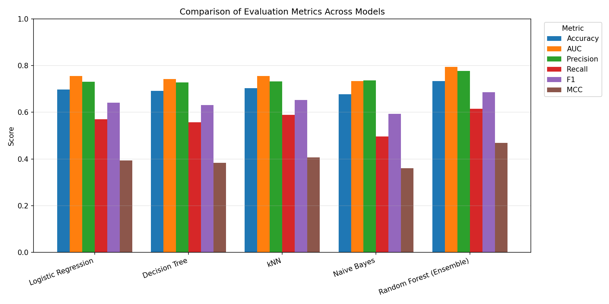
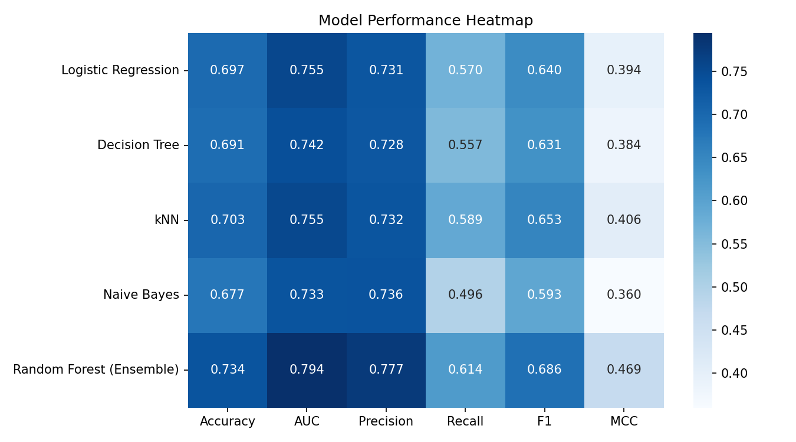
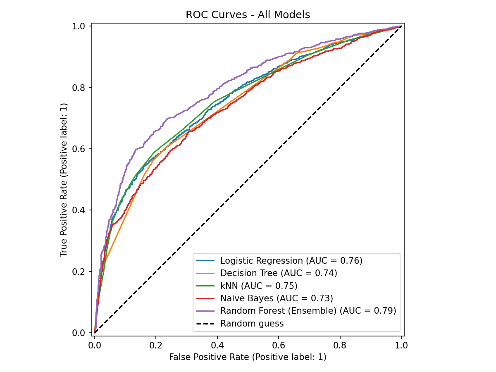

# ML Assignment 2 - Bank Marketing Classification

## Problem Statement

A bank contacts its clients by phone to sell a term deposit. Calling every client takes a lot of time and money. The aim of this project is to predict, from the client's details, whether the client will subscribe to the term deposit or not. This is a binary classification problem. I trained 5 different models on the same data and compared them using 6 metrics.

## Dataset Description

Dataset: Bank Marketing (Kaggle, originally from UCI)
Rows: 11162
Features: 16 (7 numeric, 9 categorical)
Target: deposit (yes / no) - binary classification

Numeric: age, balance, day, duration, campaign, pdays, previous
Categorical: job, marital, education, default, housing, loan, contact, month, poutcome

Why I chose this dataset:
It is a real business problem and easy to understand. It has more than 1000 rows and more than 12 features, so it meets the assignment requirements. It has both numeric and categorical columns, so I had to do encoding and scaling. It also has missing values hidden as "unknown", which I had to find and handle.

Missing values: no blank cells, but some columns have the value "unknown".
- job: 70
- education: 497
- contact: 2346
- poutcome: 8326

Duplicates: 0

Class distribution: no = 5873 (52.6%), yes = 5289 (47.4%).
The classes are almost balanced, so I did not do any resampling. I used a stratified split so that the train and test sets have the same ratio.

## GitHub Repository

https://github.com/2026ct05201/ml-assignment-2-classification

Files:
- model/bank_marketing_classification.ipynb - all the code
- data/bank.csv - full dataset
- test_data.csv - test data (20%)
- model_results.csv - metrics of all models
- requirements.txt
- metrics_comparison.png, metrics_heatmap.png, roc_curves.png - charts

How to run:
1. git clone https://github.com/2026ct05201/ml-assignment-2-classification.git
2. pip install -r requirements.txt
3. Open model/bank_marketing_classification.ipynb in Jupyter and run all cells.

## Preprocessing

- Checked duplicates (none found).
- Dropped "duration" because it is only known after the call is over.
- job and education: replaced "unknown" with the most frequent value.
- contact and poutcome: kept "unknown" as a separate category because there are too many.
- Target converted to 1 (yes) and 0 (no).
- Split 80:20 with stratify, random_state = 2026. Train = 8929, Test = 2233.
- One-hot encoding for categorical columns, StandardScaler for numeric columns.
- Imputer, encoder and scaler were fitted only on the training data.

## Models Used

- Logistic Regression (max_iter=1000)
- Decision Tree (max_depth=6, min_samples_leaf=20)
- kNN (n_neighbors=15)
- Naive Bayes (GaussianNB)
- Random Forest (n_estimators=200, max_depth=12)

| ML Model Name | Accuracy | AUC | Precision | Recall | F1 | MCC |
|---|---|---|---|---|---|---|
| Logistic Regression | 0.6968 | 0.7554 | 0.7309 | 0.5699 | 0.6405 | 0.3942 |
| Decision Tree | 0.6914 | 0.7420 | 0.7281 | 0.5567 | 0.6310 | 0.3838 |
| kNN | 0.7031 | 0.7547 | 0.7321 | 0.5888 | 0.6527 | 0.4059 |
| Naive Bayes | 0.6771 | 0.7332 | 0.7363 | 0.4962 | 0.5929 | 0.3601 |
| Random Forest (Ensemble) | 0.7335 | 0.7942 | 0.7766 | 0.6144 | 0.6860 | 0.4695 |

### Charts

## Observations

| ML Model Name | Observation about model performance |
|---|---|
| Logistic Regression | Accuracy 0.697 and AUC 0.755. It is a simple linear model but its results are close to kNN. It is fast to train and easy to understand. |
| Decision Tree | Accuracy 0.691, a little lower than Logistic Regression. I limited the depth to 6 so it does not overfit. A single tree is not very stable, so it did not perform as well as Random Forest. |
| kNN | Second best model, with accuracy 0.703 and F1 0.653. It worked well because the numeric features were scaled, since kNN depends on distance. Prediction is slower because it compares each test row with all training rows. |
| Naive Bayes | Lowest accuracy (0.677) and lowest recall (0.496), so it finds only about half of the clients who subscribed. This is because it assumes all features are independent and normally distributed, which is not true here, especially for the one-hot encoded 0/1 columns. |
| Random Forest (Ensemble) | Best model on all 6 metrics: accuracy 0.734, AUC 0.794, F1 0.686 and MCC 0.470. It combines 200 trees, so it reduces overfitting and can learn non-linear patterns better than a single tree. |

General observations:
- All models have higher precision than recall. This means that when they predict "yes" they are mostly right, but they miss many clients who actually subscribed.
- The scores are around 70% because I removed the "duration" column. With it the scores would be higher, but the model would not be realistic, because duration is only known after the call.
- I used a fixed random seed (2026), so the results stay the same every time the notebook runs.

Overall winner: Random Forest (Ensemble). It has the highest score in every metric, and its MCC of 0.47 shows it is the most balanced model for this dataset.
